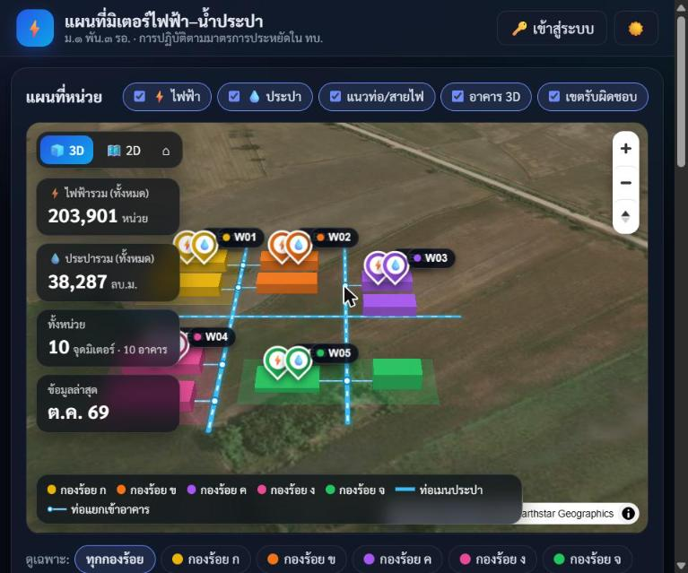
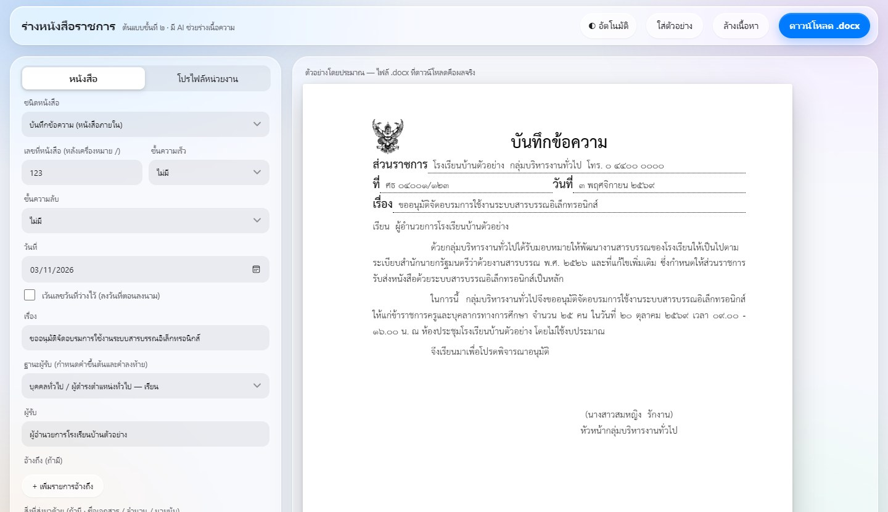
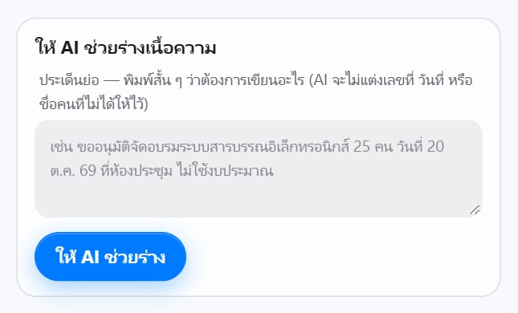
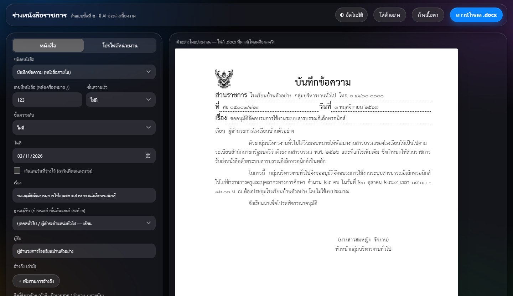
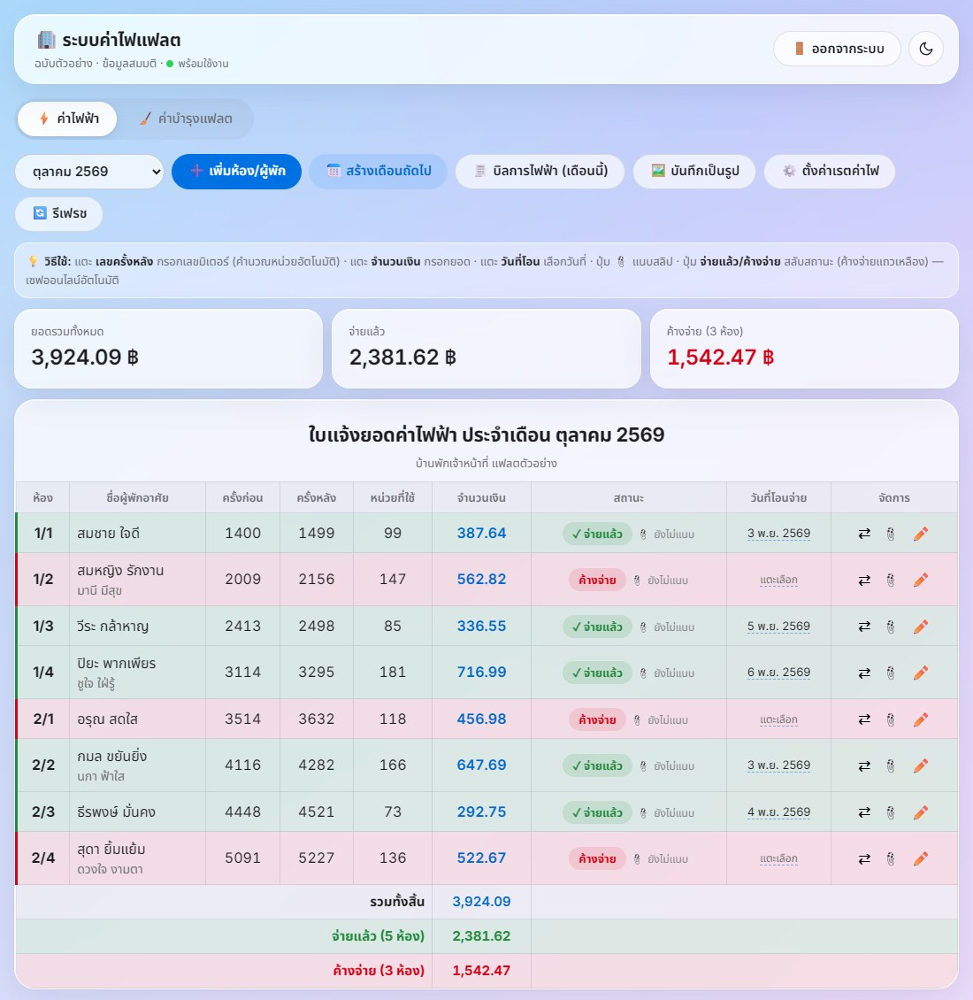
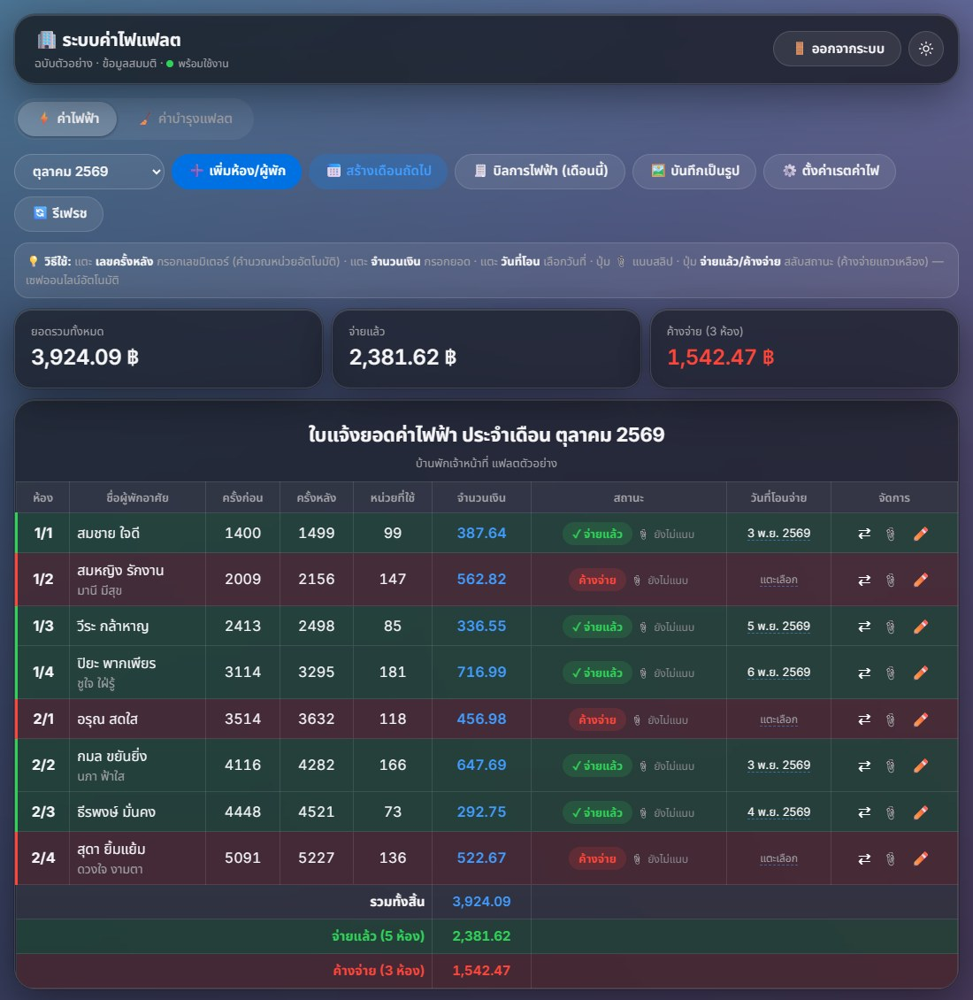

<h1 align="center">สวัสดีครับ 👋 I'm Wirunwatcha "JR" Intakaew</h1>

  <b>นักศึกษา IT มสธ. · สร้างเว็บแอปที่คนใช้งานจริง · ทำสื่อการเรียนและคลิปติว</b> 
  IT student at STOU · I build small web apps that real people use, and turn hard topics into free tutoring videos 🗺️📚📊

  
  
  
  

---

### ⭐ ผลงานเด่น · Featured work

#### 🗺️ [แผนที่มิเตอร์ไฟฟ้า–น้ำประปา · Utility Meter Map](https://github.com/intakaew/meter-map) &nbsp;·&nbsp; [ลองใช้ (ข้อมูลสมมติ) ↗](https://intakaew.github.io/meter-map/?demo)

หน่วยงานใช้งานจริง ติดตามการใช้ไฟฟ้าและน้ำประปารายเดือนตามมาตรการประหยัดพลังงาน
 A live web app a real organisation uses to track monthly electricity and water use. ข้อมูลจริงเปิดดูได้เฉพาะผู้มีรหัส · ภาพด้านล่างเป็นข้อมูลตัวอย่าง (ค่ายสมมติ)

- แผนที่ดาวเทียม 3 มิติด้วย **MapLibre GL** แสดงอาคารแยกสีตามหน่วย แนวท่อ และหมุดมิเตอร์ ติด QR ที่มิเตอร์และใช้บนมือถือได้
- แบ่งสิทธิ์ 3 ระดับ: ผู้ชม ผู้กรอก และผู้ดูแล ผู้ใช้สมัครเองแล้วรอผู้ดูแลอนุมัติ ระบบตรวจสิทธิ์ฝั่งเซิร์ฟเวอร์ทุกคำขอ
- ฝั่งเซิร์ฟเวอร์ใช้ **Google Apps Script** และเก็บข้อมูลใน Sheet/Drive แบบไม่มีค่าใช้จ่าย รหัสผ่านเก็บเป็นแฮชใส่เกลือ มีทดสอบอัตโนมัติ 34 ข้อบน Google จำลอง

#### 📝 ร่างหนังสือราชการ · Thai Official Letter Drafter &nbsp;·&nbsp; [ลองใช้ ↗](https://sarabun-m1pan3.netlify.app/)

ร่างหนังสือราชการให้ถูกรูปแบบตามระเบียบงานสารบรรณ แล้วดาวน์โหลดเป็นไฟล์ Word ได้ทันที กำลังพัฒนาเป็นบริการรายเดือน
 Drafts Thai official letters in the regulation format and exports a print-ready .docx — becoming a subscription service.

<table>
<tr>
<td width="62%"></td>
<td width="38%">  </td>
</tr>
</table>

- รองรับหนังสือครบ 7 ชนิด มีครุฑ ระยะขอบ และฟอนต์ตามระเบียบ เลือกคำขึ้นต้นและคำลงท้ายตามผู้รับให้อัตโนมัติ
- **AI ช่วยร่างเนื้อความ** ผ่านฟังก์ชันฝั่งเซิร์ฟเวอร์ที่ซ่อนคีย์ จำกัดจำนวนครั้งที่ใช้ และต้องใช้รหัสเข้าใช้
- หนังสือที่มีชั้นความลับจะไม่ถูกบันทึกและไม่ส่งให้ AI โดยล็อกไว้ทั้งฝั่งหน้าเว็บและฝั่งเซิร์ฟเวอร์ · สร้าง .docx ในเบราว์เซอร์และทดสอบเปิดด้วย Word แล้ว

🔒 ไม่เปิดเผยโค้ด เพราะกำลังทำเป็นผลิตภัณฑ์ · ภาพทั้งหมดใช้ข้อมูลสมมติ

#### 🏢 ระบบค่าไฟและค่าบำรุงแฟลต · Flat Utility Bills &nbsp;·&nbsp; [ลองใช้ฉบับตัวอย่าง ↗](https://intakaew.github.io/flat-bill-demo/) &nbsp;·&nbsp; [โค้ด](https://github.com/intakaew/flat-bill-demo)

ใช้แทนสมุดและ Excel สำหรับเก็บค่าไฟและค่าบำรุงแฟลตที่พัก ฉบับจริงมีผู้พักใช้งานอยู่ ส่วนฉบับตัวอย่างใช้ข้อมูลสมมติ ลองกดได้ทุกปุ่ม
 Replaces a paper/Excel ledger for staff-flat utility fees. Live version in use; the demo runs on made-up data.

<table>
<tr>
<td width="50%"></td>
<td width="50%"></td>
</tr>
</table>

- กรอกเลขมิเตอร์แล้วระบบคิดค่าไฟตามอัตราขั้นบันไดให้ แนบสลิปได้ แบ่งจ่ายครึ่งได้ และบันทึกใบแจ้งยอดเป็นรูปเพื่อส่งทางไลน์
- ฉบับจริงใช้ **Supabase** (PostgreSQL, Auth, Storage) กับ Netlify ส่วนฉบับตัวอย่างใช้ฐานข้อมูลจำลองในเบราว์เซอร์

#### 🎬 คลิปติว · Tutoring videos (YouTube)

ผมทำเอกสารสรุปและคลิปติวครบทุกหน่วย หน่วยละ 1 ตอน เสียงพากย์และสไลด์สร้างด้วยสคริปต์ Python ที่เขียนเอง เปิดให้ดูฟรี
 Unit-by-unit tutoring playlists, produced with my own Python slide + narration pipeline.

<table>
<tr>
<td align="center" width="20%"> <b>96414</b> การโปรแกรมคอมพิวเตอร์</td>
<td align="center" width="20%"> <b>96415</b> ระบบธุรกิจอัจฉริยะ</td>
<td align="center" width="20%"> <b>99202</b> การวิเคราะห์ข้อมูล</td>
<td align="center" width="20%"> <b>99322</b> องค์กรดิจิทัลฯ</td>
<td align="center" width="20%"> <b>สัสดี</b> ติวสอบตามตัวบทกฎหมาย</td>
</tr>
</table>

มี 4 วิชาของ มสธ. วิชาละ 15 ตอน และติวสอบสายงานสัสดี 11 ตอน พร้อม Shorts · กดภาพเพื่อเปิดเพลย์ลิสต์

---

### 🎓 การเรียน · Education

**เทคโนโลยีสารสนเทศ · มหาวิทยาลัยสุโขทัยธรรมาธิราช (มสธ.)**

- **ภาค 1/2569:** 96414 การโปรแกรมคอมพิวเตอร์ (Java) · 96415 ระบบธุรกิจอัจฉริยะ · 99202 การวิเคราะห์ข้อมูล · 99322 องค์กรดิจิทัลและการบริหารจัดการ
- **เรียนมาแล้ว:** 96408 ฐานข้อมูล / SQL · 96304 การสื่อสารข้อมูลและเครือข่าย · 96404 IT Audit และการควบคุมภายใน

---

### 🧠 ทักษะ · Skills

  

| ด้าน | ใช้ในงานจริง | จากการเรียน |
|---|---|---|
| 💻 Web | JavaScript · HTML/CSS · MapLibre GL · Google Apps Script · Supabase · Netlify / GitHub Pages | Java (OOP) |
| 🗄️ Data | PostgreSQL (Supabase) · Google Sheets as a backend · Python scripting | SQL · ER modeling · Normalization · สถิติวิเคราะห์ข้อมูล |
| 🛡️ Security | สิทธิ์ตามบทบาท · ตรวจสิทธิ์ฝั่งเซิร์ฟเวอร์ · แฮชรหัสผ่านใส่เกลือ · จำกัดจำนวนคำขอ | CIA triad · cryptography · network fundamentals |
| 🧰 Tools | ทดสอบอัตโนมัติด้วยบริการจำลอง · Git · Python + ffmpeg ทำวิดีโอ | IT Audit |

📄 <a href="./SKILLS.md">ดูทักษะแบบละเอียด · Full skills breakdown →</a>

---

  ⚡ "Build what people actually use — then test it properly." · สร้างของที่คนใช้จริง แล้วทดสอบให้ถูกวิธี

